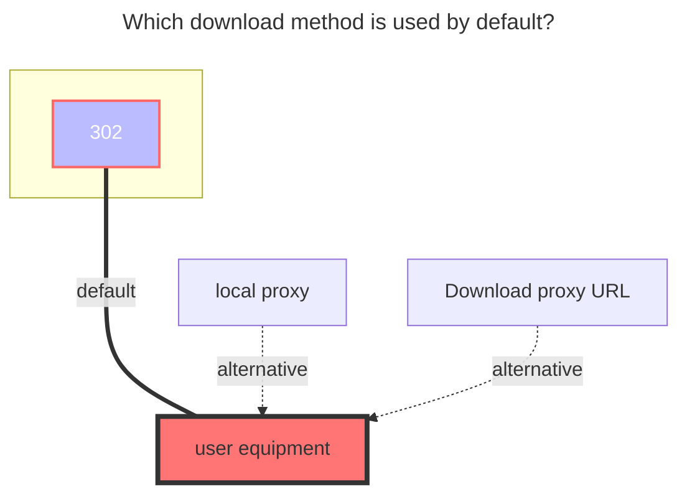

---
# This is the icon of the page
icon: iconfont icon-state
# This control sidebar order
order: 46
# A page can have multiple categories
category:
  - Guide
# A page can have multiple tags
tag:
  - Storage
  - Guide
  - "302"
# this page is sticky in article list
sticky: true
# this page will appear in starred articles
star: true
---
# WoPan

WoPan address：**https://pan.wo.cn/**

- :warning: AList v3.19.0 version and above can use this driver

::: tip

AList WoPan is web-based platform is used to access WoPan storage. 

After mounting WoPan storage using AList, please do not log in to the web version of the WoPan again, as this will log out the AList session and make the invalid.

Logging in on the mobile app does not pose any issue, as it can be done simultaneously without any conflicts.

:::

Get the token tool address：**https://alistgo.com/tool/wopan/token.html**

- 

The tool supports password, SMS code, and APP QR login.

- Password: verify your password, then enter the SMS code. If prompted, send an SMS code first.
- SMS code: enter your phone number, send an SMS code, and enter it to obtain a token.
- APP QR code: generate a code, scan it with the scanner in the WoPan APP's My page, and confirm on your phone. Generate a new code when it expires.
- If an image verification code is required, enter it in the tool. An incorrect code refreshes the image.

Copy the returned `access_token` and, when available, `refresh_token` into the matching settings. QR login may not return a refresh token; the tool indicates when it is absent. Tokens are displayed only on the current page and are not written to browser local storage.

WoPan tokens must be obtained through the tool above. Capturing login requests from the official website yourself is not supported. If the tool is temporarily unavailable, please try again later.

## **Root folder ID**

- **Personal cloud：**：**0**
  - Single folder ID：Unknown (wait for replenishment)

- **Family cloud**：Unknown (wait for replenishment)
  - Family cloud Single folder ID：Unknown (wait for replenishment)

## Type

Personal cloud：Put the `family ID` blank is the personal cloud

Family cloud：add `Family ID` Unknown (wait for replenishment)

### **AList fill in examples：**

Data obtained by using tools `Refresh_token Fill in the refresh token`, `Access_token fills in access_token`

### **The default download method used**

