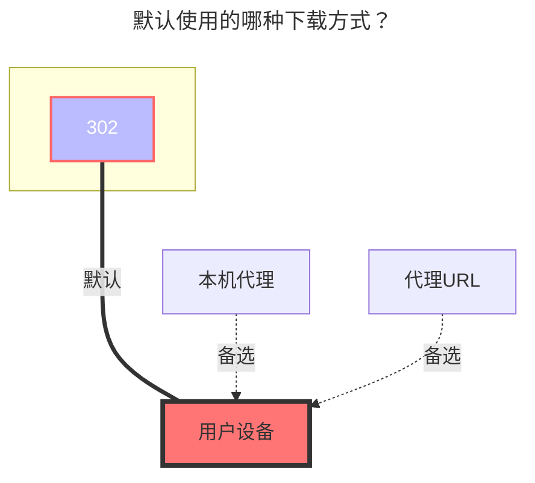

---
# This is the icon of the page
icon: iconfont icon-state
# This control sidebar order
order: 46
# A page can have multiple categories
category:
  - Guide
# A page can have multiple tags
tag:
  - Storage
  - Guide
  - "302"
# this page is sticky in article list
sticky: true
# this page will appear in starred articles
star: true
---

# 中国联通云盘

云盘地址：**https://pan.wo.cn/**

- :warning: AList 3.19.0版本及以上版本才能使用本驱动

::: tip

AList挂载联通云盘使用的是Web端

如果你先使用工具获取了令牌，再去登录网页端联通云盘会将AList挂载的踢下线导致失效

登录手机端没问题，不会被踢下线，可以同时并存。

:::

获取令牌工具地址：**https://alistgo.com/tool/wopan/token.html**

- 

工具支持三种方式：账号密码、短信验证码和 APP 扫码。

- 账号密码：验证密码后，按提示输入短信验证码；如提示尚未发送，点击发送短信验证码。
- 短信验证码：输入手机号，发送并填写短信验证码后获取令牌。
- APP 扫码：生成二维码，使用联通云盘 APP「我的」右上角扫码，并在手机端确认。二维码过期后需重新生成。
- 如出现图形验证码，在工具内填写即可；验证码错误时会刷新图片。

获取成功后，将工具返回的 `access_token` 和（如有）`refresh_token` 填入对应配置。扫码登录可能不返回刷新令牌，工具会明确提示。令牌仅显示在当前页面，不会写入浏览器本地存储。

若工具不可用，也可打开官网 https://pan.wo.cn/ 登录，通过开发者工具的网络面板查看登录请求的响应：

- 登录请求示例：
- 登录响应示例：

## **根文件夹ID**

- 个人云：**0**
  - 单独文件夹ID：未知(后续补充)

- 家庭云：未知(后续补充)
  - 家庭云单独文件夹ID：未知(后续补充)

## **类型**

个人云：将`Family ID`空着就是个人云

家庭云：填写`Family ID` 未知(后续补充)

### **AList挂载填写示例：**

将使用工具获取的 `refresh_token填入刷新令牌`，`access_token填入访问令牌`

### **默认使用的下载方式**

